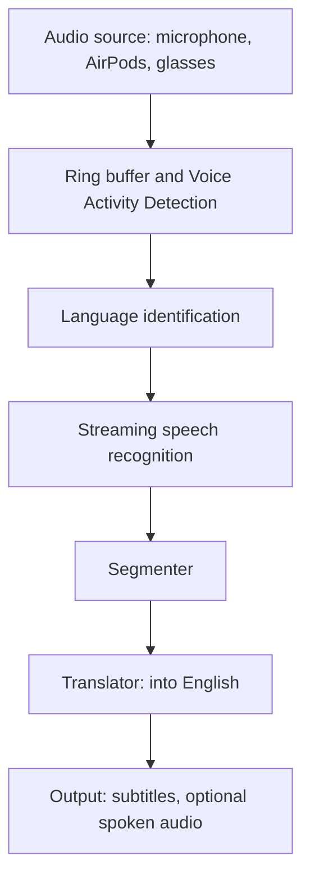

# Lifetitles

[](https://github.com/JayneeshDivecha07/Lifetitles/actions/workflows/tests.yml)

Subtitles for everyday life. Lifetitles listens through your iPhone, works out which language is being spoken, and shows the English translation as it happens.

> **Status: first working version, not yet run on a device.** The full chain is written: microphone, speech detection, Apple's on-device speech recognition, Apple's on-device translation and a SwiftUI screen. The portable core is tested, and the Apple-specific code is tested against stand-ins for Apple's frameworks, but nobody has run it on a real iPhone yet. Expect to fix small problems on the first run. See [what is verified](#what-is-verified) and the [roadmap](#roadmap).

## What it does

Lifetitles listens through the microphone, works out which language is being spoken as quickly as possible, and outputs a translation in real time.

**English is the main language.** By default, whatever language it hears is translated into English. For example, French speech in, English text out. Speech that is already English is shown as it is. Other output languages are planned for later.

### Goals

- **Low delay.** The first translated words should appear within roughly 1 to 1.5 seconds of speech. This is a target and has not been measured on real stages yet.
- **Automatic language detection.** You should not need to pick the input language.
- **On-device first.** Speech recognition and translation run on the phone where possible. Audio is not saved by default.
- **Stable text.** Translated text should not flicker as the speech recogniser revises its guesses.

## How it works

Audio flows through a chain of stages. Each stage sits behind a Swift protocol (see `Stages.swift`), so any implementation can be swapped or tested on its own.



| Stage | Job | Planned implementation |
| --- | --- | --- |
| Audio source | Delivers 16 kHz mono audio chunks. A second source replays audio files for tests. | `MicrophoneAudioSource` using `AVAudioEngine`, and `FileAudioSource` for tests (both written) |
| Ring buffer and Voice Activity Detection (VAD) | Detects speech and keeps the last half second of audio, so the first syllable is not lost. | `AudioRingBuffer` and `EnergySpeechDetector`, a loudness-based detector (written). A model-based detector can replace it later. |
| Language identification (LID) | Returns probabilities for each language. Commits once confident, then replays the buffered audio into speech recognition. | `SingleLanguageIdentifier` for a known language (written, used now). An open spoken-language model for automatic detection is still to be chosen. |
| Speech recognition (ASR, Automatic Speech Recognition) | Produces partial text while you speak, then final text. | `AppleSpeechRecognizer` using `SpeechAnalyzer` (iOS 26+, written), swappable for WhisperKit |
| Segmenter | Decides which text is stable enough to translate. | `FinalOnlySegmenter` (written, baseline) |
| Translator | Translates the stable text into English. | `AppleTextTranslator` using Apple's Translation framework (written). A cloud fallback can sit behind the same protocol. |
| Output | Shows subtitles, and live text while you speak. Optionally speaks the translation using text-to-speech (TTS). | SwiftUI screen and `SubtitleTimeline` (written). Text-to-speech is not built yet. |

The `Pipeline` type connects these stages. It treats each stretch of speech as one utterance: it identifies the language from the first second or so of speech, replays that audio into the recogniser, then streams live audio until silence ends the utterance. Utterances are translated concurrently, so a slow translation never stops the app from listening.

Every utterance is timed from the moment speech starts to language lock, first text and first translation. `LatencyTracker` records these delays and also emits them as signposts, so they appear in Instruments.

## Project layout

```text
Lifetitles/
├── Package.swift
├── Sources/
│   ├── LifetitlesCore/       Portable pipeline, no Apple-only frameworks
│   │   ├── Models/           Values passed between stages: audio, language guesses, text
│   │   ├── Stages/           One protocol per pipeline stage, plus SingleLanguageIdentifier
│   │   ├── Pipeline/         Pipeline, baseline segmenter, SubtitleTimeline
│   │   ├── Audio/            AudioRingBuffer, ChunkAssembler, EnergySpeechDetector
│   │   ├── Metrics/          LatencyTracker
│   │   └── Support/          Small internal helpers
│   └── LifetitlesApple/      Microphone, speech recognition, translation, and the engine
├── App/                      The SwiftUI screens for the iPhone app
└── Tests/
```

`LifetitlesCore` contains no user interface. `LifetitlesApple` holds everything that needs Apple's frameworks, including `LifetitlesEngine`, which wires the real stages together and exposes state for a screen. The iPhone app in `App/` is two small files on top of it.

## Run the app on an iPhone

You need a Mac with Xcode 26, an iPhone on iOS 26 or later, and a free Apple ID for signing. The simulator will not do: speech recognition models and the microphone need a real device.

1. In Xcode choose File > New > Project > iOS > App. Name it `Lifetitles`, set Interface to SwiftUI, and save it next to this folder (not inside it).
2. Delete the `ContentView.swift` that Xcode generated, and replace the generated app file with the two files from `App/`: drag `LifetitlesApp.swift` and `ContentView.swift` into the project, tick "Copy items if needed", and delete the old generated `Lifetitles App` file.
3. Add this package: File > Add Package Dependencies > Add Local, and choose this `Lifetitles` folder. When asked which products to add to the app target, tick both `LifetitlesCore` and `LifetitlesApple`.
4. In the app target's settings, set the iOS Deployment Target to 26.0.
5. Under the app target's Info tab, add two keys: `Privacy - Microphone Usage Description` and `Privacy - Speech Recognition Usage Description`. For each, write a short reason, for example "Lifetitles listens to speech so it can show subtitles."
6. Under Signing & Capabilities, choose your team. Connect the iPhone, select it as the run destination, and press Run.

On first launch the app downloads the French speech model (this needs a connection and may take a minute) and may show Apple's sheet asking you to approve the French and English translation languages. Then tap Listen and speak French. You should see grey italic text of what it hears as you speak, followed by a line of English with the French underneath. A small line of timings appears under the text.

If something fails, the status line at the top says what. The most useful things to send back are that line and, for build errors, the first error Xcode shows.

## Planned tech stack

- Swift 6, SwiftUI and Swift Concurrency
- Apple Speech (`SpeechAnalyzer`) and Translation frameworks
- Swift Package Manager: a platform-independent core package plus a thin iOS app

## Requirements

- A Mac with Xcode 26 or later
- To run the tests: nothing else. They use fake stages and generated audio. The first group runs anywhere, and the Apple-only group runs on a Mac.
- To run the app: a physical iPhone on iOS 26 or later

## Getting started

```bash
git clone https://github.com/JayneeshDivecha07/Lifetitles.git
cd Lifetitles
swift test
```

To work in Xcode, open `Package.swift`. To run the app, follow [Run the app on an iPhone](#run-the-app-on-an-iphone).

## Testing

Live microphone input is not repeatable, so tests feed scripted audio through the whole pipeline using fake stages. 59 tests run on any platform, and 2 more run only on Apple platforms. Together they check that:

- French speech is translated into English, English speech is shown without translation, and another target language can be chosen
- with a known language, recognition starts as soon as speech is confirmed, and the audio heard before that moment, including the half second before speech started, is replayed into the recogniser
- with an unknown language, the language is locked as soon as the identifier is confident, the best guess is used if it never is, and the pipeline decides when an utterance ends early or the audio stops abruptly
- live text appears before translation, and only final text is translated
- silence produces nothing, an utterance with no identifiable language is dropped, and a short pause stays inside one utterance
- two utterances stay separate, and 50 in a row all come through
- a translation error is reported and does not stop the pipeline
- cancelling the calling task stops the pipeline, and 200 pipelines running at once do not mix up their results
- latency is recorded for each milestone
- the speech detector finds speech, stops after its hangover, adapts to steady noise, and does not miss any of 30 bursts in a row
- the chunk assembler regroups odd-sized microphone buffers into steady 100 ms chunks in the right order
- the subtitle timeline keeps the newest lines and clears live text when a phrase ends
- the real detector, assembler and pipeline work together on audio delivered in awkward buffer sizes

Every pipeline test fails after one minute instead of hanging, so a stage that never ends its stream shows up as a failure. The 2 Apple-only tests cover `FileAudioSource`: one writes a generated tone to a file and replays it, the other checks that a missing file is rejected.

## What is verified

| Part | How it was checked | Not checked |
| --- | --- | --- |
| Portable core (`LifetitlesCore`) | The 59 tests above, run on Linux with Swift 6.0.3 in Swift 6 language mode: repeatedly in debug and optimised builds and under the thread sanitizer. Deliberately breaking the code was also caught by the tests. | Swift 6.2 (the version in Xcode 26) and macOS itself |
| Microphone, speech, translation and engine (`LifetitlesApple`) | Their own logic was run against stand-ins for Apple's frameworks, written from Apple's published documentation. The stand-in tests cover recognising an utterance, errors, stopping cleanly, and a full run from microphone buffers to a translated subtitle. | How Apple's real frameworks behave, which is the main risk. The microphone, `SpeechAnalyzer` and the Translation framework have never run. |
| SwiftUI screens in `App/` | Syntax checked only | Everything else, including that it compiles |
| Instruments signposts, `FileAudioSource` and its tests | Nothing | All of it. These need Apple's frameworks. |

The Apple-specific code is built in Swift 5 language mode until it has compiled cleanly on a Mac, because Apple's concurrency annotations differ between SDK versions.

### Known limits

- Only a fixed input language works for now. French is the default. Automatic language detection is not wired in.
- Subtitles appear when the recogniser finalises a phrase, which is after you pause. The baseline segmenter does not translate half-finished sentences.
- The speech detector goes by loudness. It cannot tell speech from other loud sounds, and steady noise louder than about 0.03 RMS counts as speech.
- Phone calls, other apps taking the microphone, and headphones being connected or removed while listening are not handled. Stop and start again.
- Each utterance starts a fresh speech analyzer, which may add a short delay at the start of every phrase. Real timings will show whether it matters.
- Apple's Translation framework does not list visionOS as supported, so a Vision Pro version needs a different translator.

## Roadmap

- [x] Project skeleton: Swift package, stage protocols, pipeline, latency metrics
- [x] File-replay audio source
- [x] Microphone to speech recognition to on-screen text, with a fixed input language (written, not yet run on a device)
- [x] English translation with Apple's Translation framework (written, not yet run on a device)
- [ ] Run on an iPhone, fix what the first run shows, and record real latency
- [ ] Test clips (starting with French) and accuracy checks
- [ ] A smarter segmenter that translates at pauses and sentence ends, so subtitles appear sooner
- [ ] Automatic language identification
- [ ] Handle interruptions and headphones connecting or disconnecting
- [ ] Spoken output, echo handling, AirPods audio routing and background audio
- [ ] Meta Ray-Ban glasses, using Meta's Wearables Device Access Toolkit (currently in developer preview)
- [ ] Apple Vision Pro, with a different translator
- [ ] Other output languages

### Platform plans

| Platform | Plan |
| --- | --- |
| iPhone | First target. |
| AirPods | Used as a standard Bluetooth audio route, with no special integration needed. |
| Meta Ray-Ban glasses | The app stays on the iPhone, and the glasses act as microphone and speaker. |
| Apple Vision Pro | Reuse the core package and build a visionOS interface for subtitles. Apple's Translation framework does not list visionOS, so it needs another translator. |

## Privacy

The design goal is that audio is processed on the device wherever possible and is not stored. Any cloud fallback will be optional and clearly marked.

## License

Not yet chosen.
